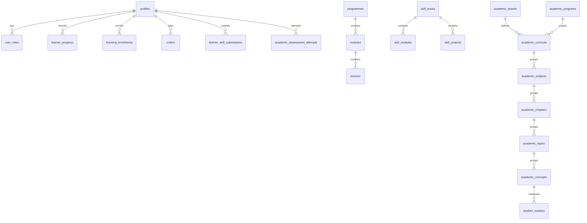

# TalentXcel.net — Phase 0 Product & Technical Audit

**Audit date:** 12 November 2026  
**Scope:** repository, deployed public product, and read-only Supabase REST observations.  
**Change control:** no application, database, deployment, DNS, environment, or dependency changes were made.

## 1. Executive summary

TalentXcel.net is a polished, publicly deployed Next.js learning-platform prototype with substantial UI, a deterministic question generator, Supabase authentication/data plumbing, and Razorpay/AI integration code. It is **not yet a verified, production-ready universal learning platform** for Classes 4–12 and competitive examinations.

The most material gap is truthfulness of the learning inventory. The public site advertises 3,000,000+ questions, but the deployed question-bank API derives that figure from source-code constants and creates questions at request time. It does not retrieve three million reviewed database records. The deployed Supabase project exposes only small seed volumes for public learning data: four academic lessons, eight skill tracks, four skill projects, eight competitive-exam batches, and four programme-price records. No production storage buckets are present.

Two immediate production security defects were verified without writing data:

1. An unauthenticated request can reach the `/admin` route by supplying a forged browser cookie. The normal anonymous request is redirected to login; the forged-cookie request receives `200 OK`.
2. The question-bank API has a production authentication bypass intended for E2E auditing. Its normal anonymous response is `401`; the bypassed request returns `200` and the generated bank metadata.

There is also a hard-coded administrator fallback in source and a client-visible, non-HTTP-only administrator cookie. No credentials are repeated in this report.

**Phase-0 classification:** the product is best described as **P2 — partially implemented**, with working public marketing/interactive prototypes and several P0/P1 technical building blocks, but with P3/P4 depth in verified content, persisted learning records, role enforcement, parent/teacher product surfaces, and live operational integrations.

## 2. Evidence standard and limits

| Label | Meaning |
|---|---|
| Verified | Direct repository inspection or read-only response from the deployed service. |
| Declared | Migration/source-code design; deployment application could differ. |
| Unverified | Requires authorised credentials, service-role metadata access, or a non-destructive test account. |

Production actions were limited to `GET`/`HEAD`-equivalent read-only requests. No account was created, no payment was initiated, no form was submitted, and no student/parent record was read. The browser automation surface could not attach to a tab, so visual/responsive and authenticated UI journeys remain unverified.

## 3. Technical architecture

```mermaid
flowchart LR
  Visitor[Public / authenticated visitor] --> CF[Cloudflare]
  CF --> Vercel[Vercel-hosted Next.js 16.4.2]
  Vercel --> App[App Router pages, route handlers and middleware]
  App --> Core[@talentxcel/core\nstatic catalogues + deterministic generators]
  App --> Supabase[Supabase project\nAuth + PostgreSQL + REST]
  App --> Razorpay[Razorpay order / signature code]
  App --> AI[OpenAI or Gemini when server key exists\notherwise deterministic mock]
  App --> CFWeb[Cloudflare Web Analytics CSP allow-list]
  App --> Static[Public assets / client-side IndexedDB]
```

### Confirmed deployment topology

- **GitHub:** `https://github.com/superapp124-cloud/TalentxcelNet.git`
- **Branch / commit:** `main`, `7687d4023b238d7db8ca34df8a7c7c895114c520` (`02 Nov 2026`).
- **Frontend:** Next.js `16.4.2`, React `19.3.0`, TypeScript, Tailwind v4, App Router, Radix UI, React Query and Zustand.
- **Repository shape:** pnpm workspace with a shared `@talentxcel/core` package and an additional `apps/app` Vite application. The Vite app is not referenced by root production scripts and appears legacy/parallel.
- **Hosting:** public responses include `x-vercel-id`; responses are fronted by Cloudflare. `www.talentxcel.net` correctly returns a `307` to the apex domain. The repository contains no `.vercel` directory or `vercel.json`, so project-level Vercel configuration is unverified.
- **Domains:** `talentxcel.net`, `academy.talentxcel.net`, and `ai.talentxcel.net` are wired in middleware. The two subdomain roots redirect unauthenticated users to login. A source-only ecosystem registry references several `talentxcel.in` domains, but no authentication/database merge was observed.
- **Supabase:** configured project URL ends `wvuvriewskvvievacida.supabase.co`. The public anonymous key is intentionally client-visible. No service-role key is present in `.env.local`, so privileged catalog, volume, policy and function inspection was not performed.
- **Storage / Edge Functions:** `supabase/functions/` contains only `.gitkeep`; the deployed storage bucket list returned an empty array. No repository-owned Edge Function is present.

### Third-party integrations

| Integration | Status | Evidence |
|---|---|---|
| Supabase Auth / PostgreSQL | P1 | Browser/server clients, middleware, migrations and public REST project respond. |
| Google OAuth | P1 | Login and registration invoke Supabase Google OAuth; live provider configuration not tested. |
| Razorpay | P1 | Order, verification and webhook code exists; deployed live credentials/payment mode not tested. Code deliberately falls back to simulated orders when keys are absent. |
| OpenAI | P1 | Router calls Chat Completions only when a server key is available. |
| Google Gemini | P1 | Router supports `gemini-1.5-flash` only when a server key is available. |
| AI fallback | P0 | Deterministic mock replies are implemented; this is not generative tutoring. |
| Analytics | P2 | First-party funnel-event route and admin display exist; Cloudflare Web Analytics is allow-listed. No GA/PostHog/Plausible implementation was found. |
| Email / Resend | P3 | Environment template and an integration helper exist; no live verification. |

## 4. Complete route inventory

### Pages (48 source routes)

| Area | Routes |
|---|---|
| Public core | `/`, `/about`, `/academy`, `/assessment`, `/academic`, `/academic/optics-lab`, `/skills`, `/game`, `/plans`, `/fees`, `/faq`, `/how-it-works`, `/faculty`, `/apply`, `/contact`, `/projects`, `/accessibility`, `/laptop-requirements` |
| Content / legal | `/blog`, `/blog/[slug]`, `/programmes`, `/programmes/[slug]`, `/programmes/class-9-foundation`, `/legal/terms`, `/legal/privacy`, `/legal/refunds`, `/legal/hardware-terms`, `/verify/[certificateNumber]` |
| Auth | `/auth/login`, `/auth/register`, `/auth/verify-email`, `/auth/error` |
| Learner | `/dashboard`, `/dashboard/question-bank`, `/dashboard/settings`, `/courses/[programmeId]`, `/courses/[programmeId]/lessons/[lessonId]`, `/projects/[projectId]` |
| Admin | `/admin`, `/admin/admissions`, `/admin/ai-analytics`, `/admin/growth-analytics`, `/admin/growth-os`, `/admin/hardware`, `/admin/life-skills`, `/admin/payments`, `/admin/programmes`, `/admin/question-bank` |

All 37 sitemap URLs returned `200` in the deployed service. Unauthenticated `/dashboard`, `/dashboard/question-bank`, and `/admin` normally returned the expected login redirect. `/game` and `/academic/optics-lab` are public but are not in the sitemap.

### API routes (27 source routes)

| Area | Endpoints |
|---|---|
| Auth | `/auth/callback`, `/auth/signout`, `/api/auth/admin-login`, `/api/auth/parent-consent` |
| AI | `/api/ai/admissions`, `/api/ai/code-mentor`, `/api/ai/navigate-ambition`, `/api/ai/report-feedback`, `/api/ai/tutor` |
| Assessment / learning | `/api/assessment/lead`, `/api/assessment/submit`, `/api/progress`, `/api/questions/bank`, `/api/projects/evaluate`, `/api/skills/backpack/evaluate`, `/api/skills/backpack/parent-observe` |
| Commerce | `/api/checkout/create-order`, `/api/checkout/entitlements`, `/api/checkout/verify-payment`, `/api/commerce/create-order`, `/api/commerce/webhook` |
| Growth / ecosystem | `/api/analytics/funnel`, `/api/ecosystem/referral/sign`, `/api/ecosystem/referral/track`, `/api/ecosystem/route`, `/api/enquiry`, `/api/health` |

## 5. Feature maturity matrix

| Product capability | Status | Evidence and qualification |
|---|---:|---|
| Public marketing, pricing, programmes, legal and blog pages | P0 | Rendered public pages and sitemap URLs return `200`; page-specific metadata is present on most content pages. |
| Class 4–12 board/class/subject selection | P1 | UI and static taxonomies cover nine classes and CBSE/CISCE/IB. Actual source curriculum records are not populated in the deployed database. |
| Academic lessons | P2 | Academic UI and code exist; deployed public database has only 4 `academic_lessons` records. No verified complete lesson library. |
| Video lessons / notes / explanations | P2 | Components and static programme/course material exist, but no populated storage buckets and no verified media inventory. |
| Free diagnostic test | P2 | Client test runner, scoring, timer and local result flow exist. Core calculation is client-side/local for the free journey; no authenticated end-to-end test was authorised. |
| Question bank | P2 | On-demand generators return questions; claims of stored verified inventory are unsupported. Authentication bypass is a P0 security issue. |
| Persisted attempts / progress | P2 | Schema and protected API code exist, but no authorised test account and no confirmed populated progression data. |
| Competitive exam preparation | P2 | 8 deployed batch records and UI/sample mocks; no verified syllabus/question/previous-paper/analytics corpus for JEE, NEET, CUET, UPSC, SSC, Banking, Railways or NDA. |
| Adaptive assessment / anti-cheating | P4 | No adaptive selection, proctoring, device controls or meaningful integrity mechanism found. |
| AI tutor / code mentor / admissions assistant | P1 | API and UI exist, with OpenAI/Gemini branches and mock fallback. Live key/model/RAG quality and rate limiting are unverified. |
| Personalised learning path / weakness detection | P2 | Data models and static planners exist, but no verified live learner data loop. |
| Skills / practical projects | P2 | 8 public tracks and 4 public project records; interactive skill prototypes and static Classes 4–9 modules exist. No persisted, verified project submission lifecycle confirmed. |
| Certificates | P2 | Certificate generation and verification route exist; issuance/persistence and tamper controls need authorised testing. |
| Student experience | P2 | Registration, login, dashboard, course and question-bank routes exist. Dashboard includes static/demo-like content alongside database reads. |
| Parent experience | P3 | Guardian relationship/consent/report schema and APIs exist; no parent dashboard route or verified journey. |
| Teacher experience | P4 | Instructor roles/tables exist, but no teacher dashboard or functional teacher workflow route was found. |
| Admin experience | P2 / P5 security | Admin screens are extensive, but route protection is bypassable and server pages do not demonstrate role checks. Do not treat as safe operations tooling. |
| Payments | P1 | Razorpay order/signature/webhook code exists. No real transaction was started; live credential/webhook/entitlement operation is unverified. |
| Offline support | P2 | IndexedDB/sync-queue code exists; no PWA manifest/service-worker verification was completed. |

## 6. Question-bank forensic audit

### Verified conclusion

The figure **3,000,000** is generated from code, not measured from an audited database inventory. `getUniversalBankSummary()` returns a literal total of 3,000,000; `getUniversalQuestionsForSubjectClassAndChapter()` creates requested questions via deterministic generator functions. The deployed API returned the same declared numbers:

| Claim surface | Observed value | Interpretation |
|---|---:|---|
| Universal generator | 3,000,000 total; 600,000 × 5 subjects | Declared generator capacity. |
| Mathematics generator | 200,000 total | Declared generator capacity. |
| Deployed `questions` REST visibility | 0 anonymous-visible rows | Not proof of zero records because RLS can mask authenticated data. |
| Deployed `math_question_bank` REST visibility | 0 anonymous-visible rows | Same RLS qualification. |
| Deployed `question_solutions` REST cache | Table absent | The table is declared by older migrations but is not in the observed REST schema cache. |

### What can and cannot be counted

- **Actual stored question total, class/board/subject/chapter/exam distribution, answer/explanation coverage, duplicate rate, incomplete records and curriculum-mapping correctness:** **unverified**. Exact counts require a read-only service-role/database report or a privileged Supabase dashboard export. No such credential was present locally.
- **Dynamically generated questions:** exact declared capacity is 3,000,000, but it must not be presented as database inventory or human-verified content.
- **Answers/explanations:** generator/static seed content supplies answers and explanations for its own response format. There is no evidence of an editorial review workflow, database quality flag, or source-traceable verification for three million distinct records.
- **Difficulty:** generated questions are assigned deterministic difficulty bands; this is not evidence of psychometric calibration.

**Marketing gap:** the production home page states “3,000,000+ Question Bank” and “verified syllabus questions.” The evidence supports “deterministically generated practice questions,” not the advertised stored/verified inventory.

## 7. Database and backend audit

### Deployed schema state

The repository contains 15 migrations, including two overlapping schema histories. Parsing migration `CREATE TABLE` statements yields **105 declared tables**. Read-only probes of every declared name found **71 tables visible in the production REST schema cache** and **34 declared names absent**. This is a material schema-drift signal; it does not identify the exact migration history applied to production.

**Present in REST cache (71):** `academic_assessment_attempts`, `academic_boards`, `academic_chapters`, `academic_concepts`, `academic_curricula`, `academic_curriculum_concepts`, `academic_doubt_sessions`, `academic_exam_calendar`, `academic_exam_concepts`, `academic_examinations`, `academic_lessons`, `academic_mastery_events`, `academic_parent_reports`, `academic_prerequisites`, `academic_programs`, `academic_revision_plans`, `academic_student_guardians`, `academic_subjects`, `academic_topics`, `admissions_applications`, `ai_conversations`, `ai_messages`, `ai_usage_events`, `announcements`, `assessment_attempts`, `assessment_responses`, `assessments`, `audit_events`, `bookmarks`, `certificates`, `commercial_orders`, `competitive_exam_batches`, `consent_records`, `course_instructors`, `ecosystem_brands`, `ecosystem_campaigns`, `ecosystem_domains`, `ecosystem_knowledge_index`, `ecosystem_referrals`, `funnel_analytics_events`, `interaction_history`, `knowledge_chunks`, `knowledge_documents`, `leads`, `learner_entitlements`, `learner_growth_recommendations`, `learner_notes`, `learner_progress`, `learner_skill_submissions`, `learning_enrolments`, `learning_outcomes`, `lessons`, `math_learner_progress`, `math_question_bank`, `modules`, `orders`, `payment_transactions`, `payment_webhook_events`, `profiles`, `programme_prices`, `programmes`, `questions`, `refund_requests`, `skill_modules`, `skill_projects`, `skill_tracks`, `student_error_dna`, `student_mastery`, `support_messages`, `support_tickets`, `user_roles`.

**Absent from observed REST cache (34):** `assessment_blueprints`, `attempt_answers`, `attempts`, `blueprint_questions`, `chapter_game_configs`, `chapters`, `classes`, `credit_ledger`, `curriculum_boards`, `curriculum_versions`, `entitlements`, `exam_categories`, `exam_versions`, `exams`, `game_levels`, `game_missions`, `game_session_questions`, `game_sessions`, `game_themes`, `guardian_learner_relationships`, `learner_achievements`, `learner_game_profiles`, `learner_powerups`, `learner_profiles`, `learner_topic_mastery`, `learner_xp_transactions`, `payment_events`, `products`, `question_solutions`, `refunds`, `subject_game_configs`, `subjects`, `syllabus_mappings`, `topics`.

### Publicly observable data volumes

These are exact only where public RLS permits reads; a returned zero for a private table must not be interpreted as an empty table.

| Table | Observed public count |
|---|---:|
| `academic_lessons` | 4 |
| `skill_tracks` | 8 |
| `skill_projects` | 4 |
| `competitive_exam_batches` | 8 |
| `programme_prices` | 4 |
| Deployed storage buckets | 0 |
| New academic knowledge-graph tables | 0 visible records each |
| `questions` / `math_question_bank` | 0 anonymous-visible records each |

### Relationship map (declared architecture)



### RLS, functions, triggers and indexes

- Migrations declare RLS broadly across curriculum, assessment, commerce, profile, game, skills and knowledge-graph tables, with self-scoped learner policies and selected public-read catalogue policies.
- Migrations declare database functions/triggers for assessment submission, profile creation, timestamps, role checks and other operations; actual production function/policy/index state is **unverified** without privileged metadata access.
- The dual migration histories and missing REST tables make a clean migration-baseline and schema-drift review mandatory before any new learning data is added.
- No production bucket exists despite migration declarations for course materials, learner submissions and application documents.

## 8. Student journey test results

| Journey | Result | Evidence / blocker |
|---|---|---|
| New registration | P1 source implementation | Supabase email/password and Google OAuth calls exist. Creating a production account was outside the audit-only scope. |
| Board / class selection | P1 source + public page | Public UI exposes CBSE/CISCE/IB and Classes 4–12. Browser interaction could not be attached. |
| Subject / chapter selection | P2 | Static UI/taxonomy exists, but deployed academic content is tiny and legacy curriculum tables are missing. |
| Start diagnostic / attempt questions | P2 | Client runner and local scoring flow exist; real UI execution not completed. |
| View results | P2 | Results render in client state; no verified persistence or authenticated reporting. |
| Use AI tutor | P1 source implementation | Authentication-gated API and provider/fallback code exist; no paid/provider call made. |
| Competitive preparation | P2 | Eight batch records and sample-mock UI; complete exam journey/corpus unverified. |
| Progress / parent report | P2/P3 | Schema/API concepts exist; requires a safe learner/guardian account to validate. |

No payment, lead, consent, or support form was submitted. This protects production records but leaves those workflows unverified.

## 9. SEO, performance, accessibility and security

### SEO / AEO / GEO

- **P0:** `robots.txt`, `sitemap.xml` (37 URLs), HTTPS, canonical www-to-apex redirect, root metadata, Open Graph, Twitter metadata and Organization/WebSite JSON-LD are present.
- **P2:** canonical URLs are not consistently defined on every public page; several primary product pages use only the root title/description.
- **P2:** the sitemap has no class/board/subject/chapter/lesson pages, so scalable curriculum discoverability is absent.
- **P2:** `SearchAction` structured data points to `/assessment?q=…`, but no verified search result implementation was found.
- **P2:** Cloudflare blocks AI-training crawlers; search indexing is allowed. This protects content but does not itself establish AEO/GEO quality.
- **P3:** no rich FAQ/FAQPage schema audit result, no verified content freshness strategy, and no indexable curriculum-source citations were found.

### Performance / accessibility

- **P1:** Next image formats, font-display swap, responsive viewport limits and hero-image preloads are configured.
- **P2:** no production Core Web Vitals/RUM implementation was found; neither Lighthouse nor device interaction could be completed in this audit.
- **P2:** an accessibility statement page is live, but automated keyboard/screen-reader and mobile breakpoint testing remains outstanding.
- **P2:** the full test suite did not complete within the audit time window and was stopped; no passing test result is claimed.

### Critical security findings

| Severity | Finding | Verified evidence |
|---|---|---|
| Critical | Forged client cookie bypasses `/admin` route protection. | Production anonymous request: `307` login; identical request with forged administrator cookie: `200`. Middleware trusts an email-valued client cookie. |
| Critical | Hard-coded administrator fallback and client-readable administrator session state. | Source contains hard-coded fallback logic and sets administrator/E2E cookies without `httpOnly`. Do not rely on this mechanism for any environment. |
| High | Question-bank authentication bypass deployed in production. | Normal unauthenticated API request: `401`; E2E bypass response: `200`, including generated-bank metadata. The bypass is not restricted to local/test environments. |
| High | Privilege model is not server-enforced for admin routes/pages. | Middleware only ensures a user/cookie exists for `/admin`; it does not resolve/require a database role. Admin server pages query operational tables without a demonstrated authorization guard. |
| High | Dependency vulnerability. | `pnpm audit --prod` reports one high-severity Zod denial-of-service advisory (`GHSA-mrhx-c7xc-m3w5`) affecting installed 3.x versions. |
| Medium | CSP permits `unsafe-inline` and `unsafe-eval`. | Confirmed in live response headers and `next.config.ts`; this weakens XSS containment. |
| Medium | Growth analytics event endpoint accepts public client events. | Appropriate for telemetry only with strict volume/rate controls; anti-abuse controls were not found. |
| Medium | Schema/deployment drift. | 34 migration-declared tables are absent from the live REST schema cache, including old curriculum, question-solution and gamification tables. |
| Medium | Security headers incomplete. | Good headers exist (HSTS, frame/type/referrer/permissions policies), but no COOP/COEP/CORP policy was observed and CSP is permissive. |

## 10. Working assets worth preserving

- App Router information architecture, public page quality, and global SEO foundation.
- Shared deterministic curriculum/question generator as a **practice-content generator**, provided it is labelled accurately.
- Class 4–9 life-skills catalogue and interactive prototype components.
- Supabase SSR session plumbing and email/Google authentication integration pattern.
- Razorpay server-signature verification design, subject to credential/live-webhook validation.
- Educational UI components: quiz runner, course player, project workspace, AI tutor drawer, dashboards and offline queue abstractions.
- RLS-oriented target schema and knowledge-graph modelling intent, after reconciliating schema drift.

## 11. Critical debt and missing functionality

1. Fix the two verified authentication/authorization defects before collecting more production data or running paid operations.
2. Establish a single migration lineage and reconcile live schema, RLS, functions, storage and source types.
3. Replace marketing capacity claims with a data-backed, reviewable question/content inventory.
4. Build an editorial pipeline: provenance, board/version mapping, reviewer, answer/explanation status, difficulty validation, duplicate detection and retirement/versioning.
5. Add genuine learning persistence: attempts, answers, progress, mastery, recommendations, parent reporting and role-aware dashboards.
6. Implement actual competitive-exam products: exam blueprints, time limits, scoring/negative marking, previous papers/licensing, analytics and syllabus mapping.
7. Validate payment and entitlement lifecycle in a sandbox with webhook replay/idempotency tests.
8. Add role middleware/server guards and rate limiting/abuse controls.
9. Add observability: error tracking, privacy-aware RUM, API audit logging, backup/restore and data-retention controls.
10. Complete accessibility/mobile/real-device testing and a reliable CI test gate.

## 12. Indicative effort and sequence (no work authorised)

| Phase | Objective | Indicative effort |
|---|---|---:|
| 1 | Security remediation, access-control tests, dependency update, secret rotation assessment | 1–2 weeks |
| 2 | Supabase production schema/RLS/storage reconciliation and migration baseline | 2–3 weeks |
| 3 | Truthful content inventory + editorial/question-bank pipeline | 4–8 weeks |
| 4 | Core learner journey: account, enrolment, assessment, persistence, progress | 4–6 weeks |
| 5 | Parent/teacher/admin role experiences and reporting | 3–5 weeks |
| 6 | Exam verticals, payment/entitlements, AI evaluation and quality controls | 6–12 weeks |
| 7 | SEO content expansion, accessibility, performance/RUM, E2E/mobile QA | 3–5 weeks |

These ranges are planning inputs only, not a development commitment. They assume a small cross-functional team and do not include content authoring/licensing at scale.

## 13. Recommended decision gate

Do not begin a feature redesign or large-scale content import yet. First approve a focused remediation/discovery phase that obtains **read-only Supabase dashboard access** and one or more **authorised non-production test accounts**. Its exit criteria should be: verified schema/RLS inventory, removed test/admin bypasses, confirmed payment/AI configuration, a reconciled content count, and a signed-off minimum learner journey.

---

### Primary evidence locations

- `app/api/questions/bank/route.ts`
- `packages/core/src/universal-engine/generators.ts`
- `lib/supabase/middleware.ts`
- `app/api/auth/admin-login/route.ts`
- `components/auth/login-form.tsx`
- `lib/ai/router.ts`
- `lib/commerce/razorpay.ts`
- `next.config.ts`, `app/layout.tsx`, `app/robots.ts`, `app/sitemap.ts`
- `supabase/migrations/*.sql`
